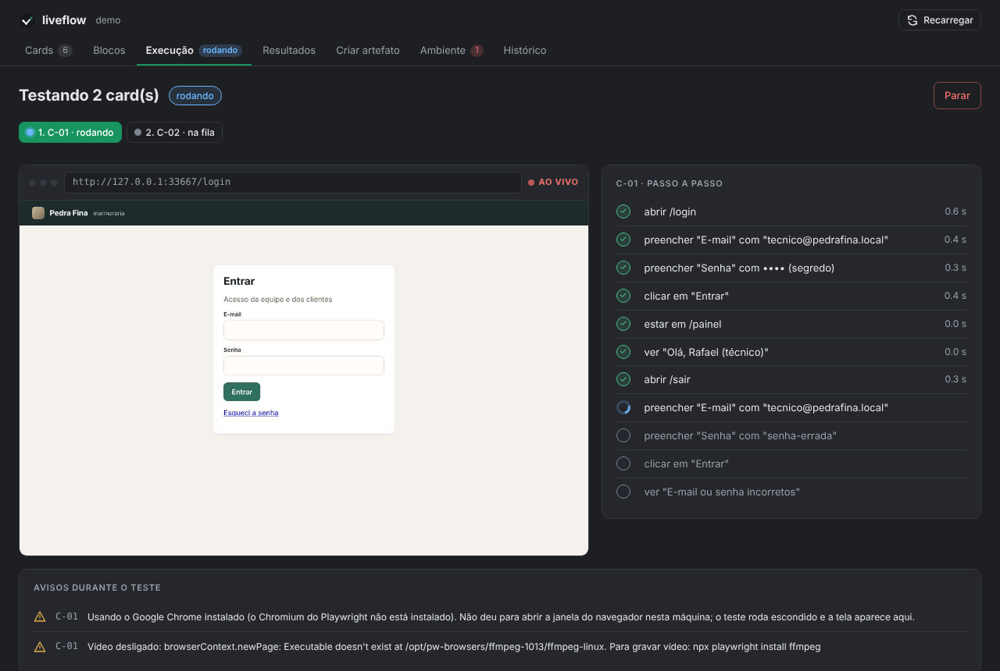
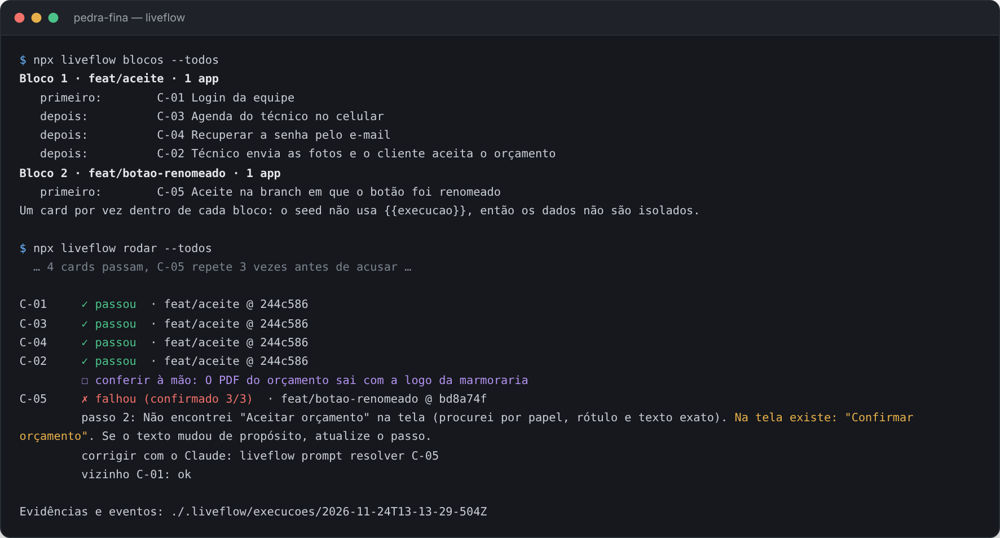
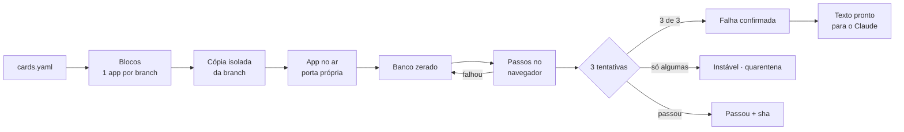
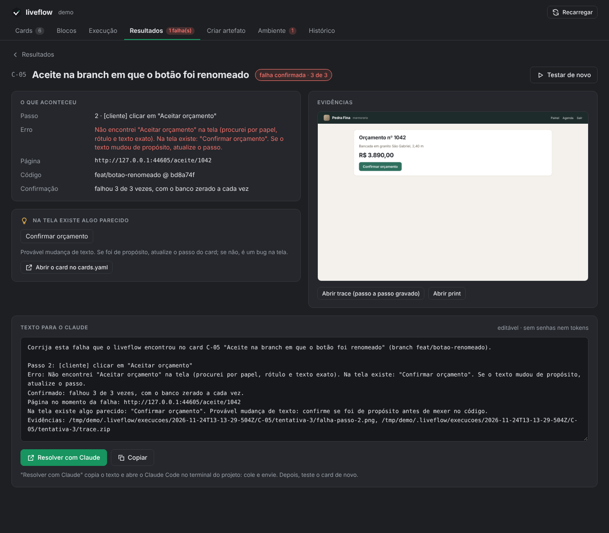

<div align="center">


# liveflow

**Testa o fluxo de tela de cada card antes de entregar. A IA escreve; o liveflow executa.**

[](https://github.com/joaocarpim/live-flow/actions/workflows/ci.yml)
[](https://github.com/joaocarpim/live-flow/releases/latest)
[](LICENSE)
[](https://nodejs.org)
[](docs/extensao.md)
[](docs/claude.md)

[Início rápido](#início-rápido) · [Como funciona](#como-funciona) · [Extensão](#extensão-do-vs-code) · [Claude Code](#com-o-claude-code) · [CI](#no-ci) · [Documentação](docs)

<br>



</div>

## O problema

A entrega passa nos testes unitários, o PR é aprovado, e o cliente descobre que o botão "Aceitar orçamento" virou "Confirmar orçamento" e o fluxo inteiro parou. Testes de ponta a ponta escritos à mão resolvem, mas custam caro para escrever, quebram por qualquer detalhe e quase nunca acompanham os critérios de aceite do card.

O **liveflow** parte do card. Cada card do `.liveflow/cards.yaml` tem os critérios de aceite e um passo a passo em linguagem simples (`abrir`, `clicar`, `preencher`, `ver_texto`…). O liveflow sobe o código da branch do card numa cópia isolada, zera o banco, executa os passos num navegador de verdade e só acusa falha quando ela se repete **3 de 3 vezes**.

## O que ele faz

- **Testa o código certo.** Cada branch roda numa cópia isolada (`git worktree`), com o app subindo na porta dela. O resultado traz o commit exato. Sem garantia de qual código está no ar, o resultado é "não rodou", nunca um "passou" duvidoso.
- **Não chuta.** Dois botões com o mesmo texto fazem o teste falhar por ambiguidade em vez de clicar no primeiro. Botão sumiu? Ele mostra o que existe parecido na tela (`Na tela existe: "Confirmar orçamento"`), separando "o texto mudou" de "é um bug".
- **Repete antes de acusar.** Falha confirmada é 3 de 3, com o banco zerado a cada tentativa. Falhou e depois passou é **instável**: vai para quarentena e não bloqueia ninguém.
- **Fluxos reais.** Várias pessoas no mesmo card (o técnico envia a foto, o cliente aceita pelo link), valores guardados entre passos, upload de arquivos, e-mail de teste, tela de celular, conferências que só uma pessoa pode fazer.
- **Organiza em blocos.** Cards da mesma branch dividem o mesmo app; dependências rodam antes; paralelo só quando os dados são isolados.
- **Pega quebra escondida.** No modo completo, roda de novo os cards já aprovados que mexem nos mesmos arquivos e compara com a base.
- **Funciona onde você está.** Terminal, extensão do VS Code com execução ao vivo, plugin do Claude Code, hook de pre-push e GitHub Action, todos lendo os mesmos eventos.



## Início rápido

### Em 3 minutos, com a demo

O repositório traz uma mini marmoraria (técnico, orçamento, cliente, agenda no celular, recuperar senha) com 6 cards.

```bash
git clone https://github.com/joaocarpim/live-flow && cd live-flow && npm install
bash exemplo/criar-demo.sh /tmp/pedra-fina
cd /tmp/pedra-fina && npm install && npx playwright install chromium
export LIVEFLOW_SEGREDO_SENHA=pedra123
npx liveflow rodar --todos
```

Você vai ver quatro cards passarem, um falhar de verdade (o botão foi renomeado numa branch) e um ficar de fora por não ter passo a passo.

### No seu projeto

```bash
npm i -D github:joaocarpim/live-flow playwright
npx playwright install chromium
npx liveflow iniciar          # cria .liveflow/cards.yaml de exemplo
npx liveflow ambiente         # o que falta para testar de forma certeira
npx liveflow rodar C-01 --ao-vivo
```

> Requer **Node 22.18 ou mais novo** e **Playwright** no projeto testado. Sem o Chromium do Playwright, o liveflow usa o Google Chrome instalado.

## Um card

```yaml
- id: C-02
  titulo: Técnico envia as fotos e o cliente aceita o orçamento
  branch: feat/aceite
  depende_de: [C-01]
  criterios:
    - O técnico cria o orçamento e envia as fotos da vistoria
    - O cliente aceita pelo link
  como_testar:
    - abrir: /painel
      como: tecnico
    - clicar: Criar orçamento
      como: tecnico
    - guardar: { nome: orc, da_url: "/orcamentos/(\\d+)" }
      como: tecnico
    - enviar_arquivo: { campo: Fotos, arquivos: [.liveflow/arquivos/vistoria.jpg] }
      como: tecnico
    - clicar: Enviar fotos
      como: tecnico
    - ver_texto: 1 foto(s) recebida(s)
      como: tecnico
      criterio: 1
    - abrir: /aceite/{{orc}}
      como: cliente
    - clicar: Aceitar orçamento
      como: cliente
    - ver_texto: Orçamento {{orc}} aceito
      como: cliente
      criterio: 2
    - conferir_manual: O PDF do orçamento sai com a logo da marmoraria
```

Sem seletor de CSS, sem código de teste: o passo usa o texto que a pessoa vê. Pode ser escrito à mão, **gravado** (`liveflow gravar C-02`: você faz o fluxo no navegador e ele vira passos) ou escrito pelo **Claude**. Formato completo em [docs/artefato.md](docs/artefato.md).

## Como funciona



1. **Blocos.** Cards com a mesma `branch` viram um bloco: o app sobe uma vez para todos. `depende_de` define a ordem; `altera` impede que dois cards mexam na mesma coisa ao mesmo tempo.
2. **Código certo.** Para cada bloco, o liveflow cria uma cópia da branch, reaproveita o `node_modules` se o lockfile for igual ao seu, sobe os serviços (inclusive de outro repositório, como a API) e espera o app responder.
3. **Execução.** Antes de cada tentativa roda o `seed`. Os passos rodam num processo separado, com Playwright, uma sessão de navegador por pessoa (`como:`).
4. **Veredito.** Passou, falha confirmada (3/3), instável ou não rodou, sempre com o motivo, o commit, o print, o vídeo e o trace.

Detalhes em [docs/como-funciona.md](docs/como-funciona.md).

## Extensão do VS Code

Lista de cards, prévia dos blocos, execução ao vivo com a tela do app dentro do painel, resultado com sugestão quando o texto mudou e botão **Resolver com Claude**. Segredos ficam no cofre do VS Code.

<table>
<tr>
<td width="50%"><br><sub><b>Cards</b>: quais podem ser testados e a última situação de cada um</sub></td>
<td width="50%"><br><sub><b>Blocos</b>: como os cards vão rodar, modo e "assistir ao vivo"</sub></td>
</tr>
<tr>
<td><br><sub><b>Problema</b>: falha confirmada, o que existe na tela, print e texto para o Claude</sub></td>
<td><br><sub><b>Card</b>: critérios, passo a passo, camadas de teste e histórico</sub></td>
</tr>
<tr>
<td><br><sub><b>Vários cards</b>: progresso por card, tentativa 1, 2 ou 3 de 3</sub></td>
<td><br><sub><b>Ambiente</b>: o que falta, segredos, hook e GitHub Actions</sub></td>
</tr>
</table>

Instalação: baixe o `.vsix` da [última release](https://github.com/joaocarpim/live-flow/releases/latest) e use **Extensões → … → Instalar a partir de VSIX** (no Marketplace, ela vai aparecer como **liveflow cards**). Mais em [docs/extensao.md](docs/extensao.md).

## Com o Claude Code

O plugin traz a skill **liveflow**: escrever o passo a passo lendo o código das telas, criar o artefato com os seus cards e corrigir falhas confirmadas, escrevendo antes um teste que reproduz o problema.

```text
/plugin install liveflow --marketplace joaocarpim/live-flow
```

Ou pelo terminal: `claude plugin marketplace add joaocarpim/live-flow` e `claude plugin install liveflow@liveflow`.

A IA nunca executa o teste. Ela escreve o card; o liveflow roda sempre do mesmo jeito. Veja [docs/claude.md](docs/claude.md).

## No CI

```yaml
# .github/workflows/liveflow.yml
on: [pull_request]
jobs:
  cards:
    runs-on: ubuntu-24.04
    steps:
      - uses: actions/checkout@v5
        with: { fetch-depth: 0 }
      - uses: actions/setup-node@v5
        with: { node-version: 22 }
      - run: npm ci && npx playwright install --with-deps chromium
      - uses: joaocarpim/live-flow@main   # cards da branch do PR
        env:
          LIVEFLOW_SEGREDO_SENHA: ${{ secrets.LIVEFLOW_SEGREDO_SENHA }}
```

Também: `liveflow hook instalar` (cards da branch antes de cada push) e `liveflow ci gerar` (PR + regressão noturna dos cards entregues). Veja [docs/ci.md](docs/ci.md).

## Comandos

| Comando | Para |
|---|---|
| `liveflow cards` | listar os cards e o que falta em cada um |
| `liveflow blocos C-01 C-02` | ver como os cards vão rodar |
| `liveflow rodar C-01 C-02` / `--todos` / `--da-branch` / `--regressao` | testar |
| `liveflow rodar C-01 --ao-vivo` | um card com o navegador visível |
| `liveflow gravar C-04 --salvar` | gravar o passo a passo fazendo o fluxo |
| `liveflow prompt resolver C-05` | texto para o Claude corrigir a última falha |
| `liveflow plano C-01` | o que cada camada de teste faz no card |
| `liveflow ambiente` | conferir o que falta |
| `liveflow historico` | últimas execuções e quarentena |
| `liveflow limpar --dias 14` | apagar evidências antigas |

Referência completa em [docs/comandos.md](docs/comandos.md).

## Princípios

1. **A IA só escreve, nunca executa.** O mesmo card roda sempre do mesmo jeito.
2. **Só afirmar o que foi verificado.** Problema de ambiente nunca vira "falha do card".
3. **Repetir antes de acusar.** 3 de 3, com banco zerado.
4. **Nunca chutar.** Ambíguo é falha, não clique no primeiro.
5. **Nada some em silêncio.** O que não roda aparece com o motivo.
6. **Alvo travado.** Só endereços permitidos; produção nunca.
7. **Segredo não vai para arquivo** nem para o texto da IA.

## Estado do projeto

O liveflow está na versão **0.1**. Das 25 camadas de teste planejadas, rodam hoje **fluxo completo** e **regressão dos vizinhos**; as outras aparecem no plano de cada card como "ainda não roda". Veja o [roadmap](docs/roadmap.md).

| | Hoje |
|---|---|
| Passo a passo, contas, upload, e-mail, celular, jornadas | ✅ |
| Blocos, cópia por branch, vários serviços e repositórios | ✅ |
| Repetição 3/3, quarentena, sugestões de texto, vizinhos | ✅ |
| Extensão do VS Code, plugin do Claude Code, Action, pre-push | ✅ |
| Segurança, unitária, carga, acessibilidade e outras camadas | 🗓️ [roadmap](docs/roadmap.md) |
| Windows | ⚠️ ainda não testado |

## FAQ

<details><summary><b>Preciso escrever código de teste?</b></summary>

Não. O passo a passo é YAML com o texto que aparece na tela. Dá para gravar fazendo o fluxo ou pedir ao Claude.
</details>

<details><summary><b>Por que testar cards e não a branch inteira?</b></summary>

Falha precisa apontar a entrega e o critério. Um fluxo da branch inteira falha vago ("passo 23") e envelhece a cada commit. A branch continua importante: ela diz qual código o card testa (`branch:` no card).
</details>

<details><summary><b>Meu frontend e minha API estão em repositórios diferentes.</b></summary>

Use `sistema.servicos` com `repo: ../api`. O liveflow usa a branch de mesmo nome no outro repositório; se ela não existir, usa a base e escreve isso no resultado.
</details>

<details><summary><b>Posso rodar em paralelo?</b></summary>

Sim, quando os dados são isolados por execução: `paralelo: 3`, `iniciar` com `{{porta}}` e `seed` com `{{execucao}}` (por exemplo, uma empresa de teste por execução). Sem isso, um card por vez, no mesmo app.
</details>

<details><summary><b>O que acontece com prints e vídeos?</b></summary>

Ficam em `.liveflow/execucoes/` (fora do git) e são apagados depois de `sistema.guardar_dias` (14 por padrão), porque podem ter dados pessoais.
</details>

## Contribuir

Issues e PRs são bem-vindos. Leia o [CONTRIBUTING.md](CONTRIBUTING.md): `npm install`, `npm test` (inclui os testes com navegador) e um teste para cada mudança.

## Licença

[MIT](LICENSE) © João Carpim
