# Extensão do VS Code

A extensão é a interface; quem testa é a mesma CLI, empacotada dentro dela. Ela lê o mesmo `events.ndjson`, então o painel mostra exatamente o que o terminal mostraria.

## Instalar

1. Baixe o `liveflow-*.vsix` da [última release](https://github.com/joaocarpim/live-flow/releases/latest), ou gere:
   ```bash
   cd extensao && node build.mjs && npx --prefix .. vsce package --no-dependencies
   ```
2. No VS Code: **Extensões → … → Instalar a partir de VSIX**.
3. Abra um projeto com `.liveflow/cards.yaml`. O ícone do liveflow aparece na barra de atividades.

Configuração: `liveflow.node` (padrão `node`), o executável do Node 22.18+.

## Telas

### Barra lateral
Cards com a última situação, resumo do ambiente, "Abrir painel" e "Testar prontos".

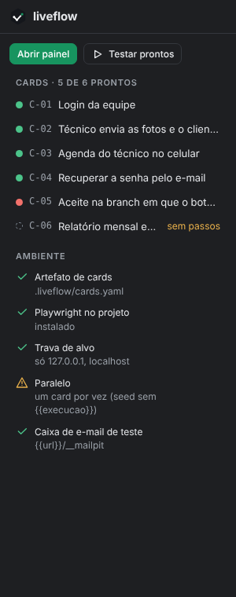

### Cards
Busca, filtros e seleção. Card sem passo a passo não pode ser marcado e diz o que falta.

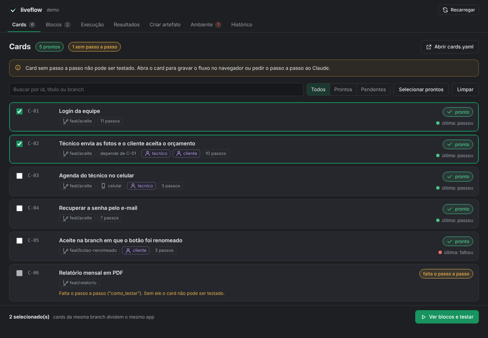

### Card
Critérios com o passo que prova cada um, passo a passo com quem faz cada passo, como roda (código, tela, dependências), as 25 camadas por modo e o histórico. Botões: **Testar este card**, **Gravar passo a passo**, **Pedir ao Claude**, **Abrir no cards.yaml**.

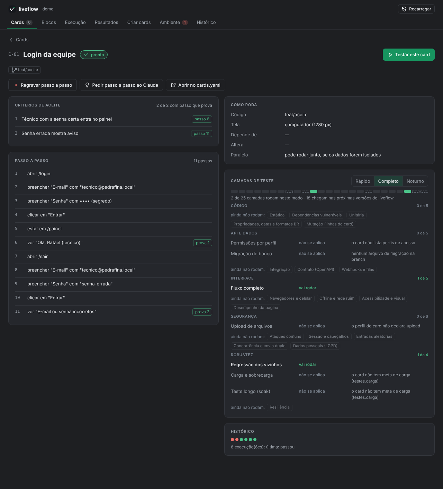

### Blocos
Como os cards vão rodar, modo (rápido, completo, noturno) e "Assistir ao vivo" (um card escolhido).

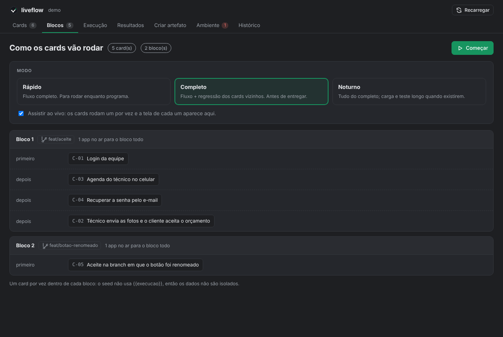

### Execução
Ao vivo: a tela do app aparece no painel, quadro a quadro, ao lado do passo a passo. Com vários cards: progresso por card e a tentativa (1, 2 ou 3 de 3). **Parar** desliga apps e navegadores e remove as cópias.

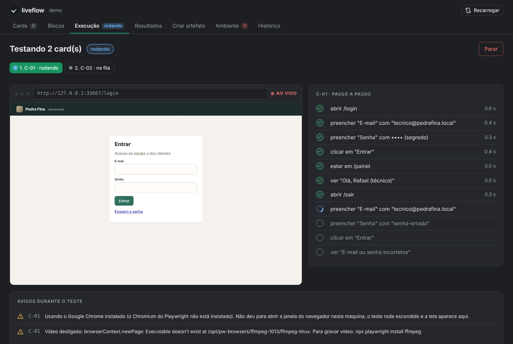
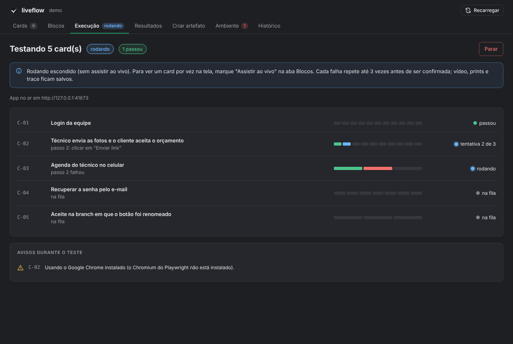

### Resultados e Problema
Resultado por card com o commit testado, pendências de conferência manual e vizinhos. No problema: o que aconteceu, o que existe parecido na tela, print, trace e o texto para o Claude, editável.

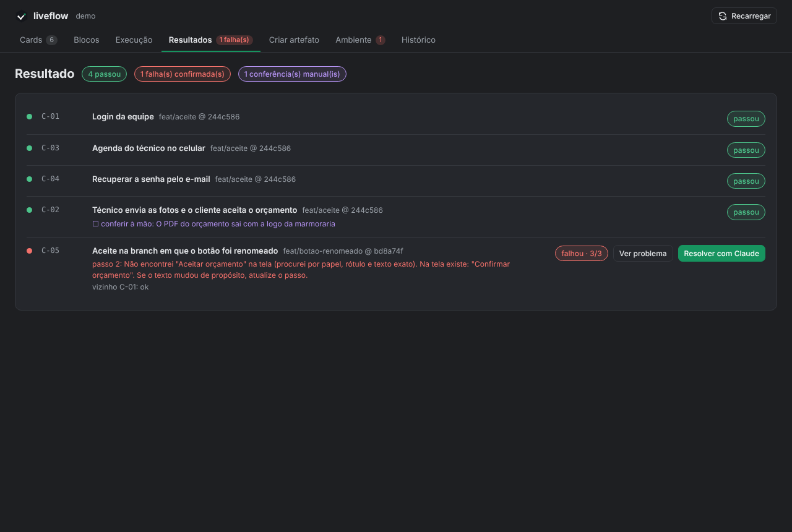
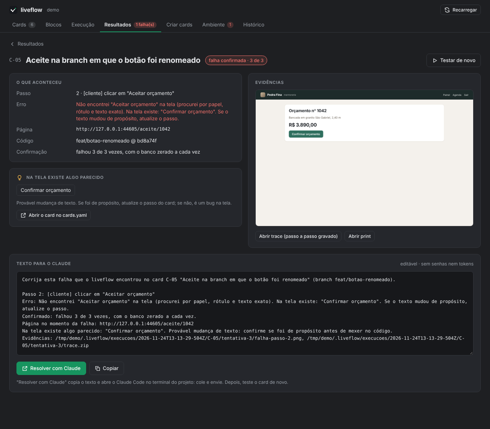

**Resolver com Claude** copia o texto e abre o Claude Code no terminal do projeto; você cola e envia. Colar sozinho não é garantido em todo ambiente, por isso o texto sempre vai para a área de transferência.

### Criar artefato
Mostra o que o liveflow encontrou no projeto, sem IA: repositórios (worktrees contam uma vez), tecnologias, scripts de subir e de seed, docker e os nomes das variáveis do `.env` de exemplo. Cole os cards do seu quadro (id, título, critérios, branch) e clique em **Gerar texto para o Claude**: o texto leva esse levantamento, e o Claude escreve o `.liveflow/cards.yaml` inteiro, com o bloco `sistema` (como subir cada serviço) e o passo a passo de cada card. Para um card que já existe, a tela do card também tem **Gravar passo a passo no navegador**.

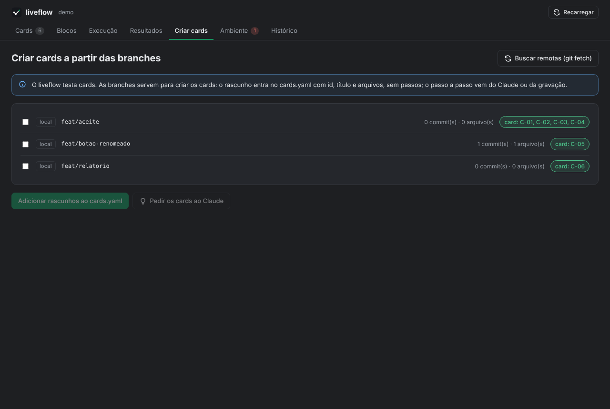

### Ambiente e Histórico
O que falta (com o comando que resolve), segredos e serviços. Histórico por card e quarentena.

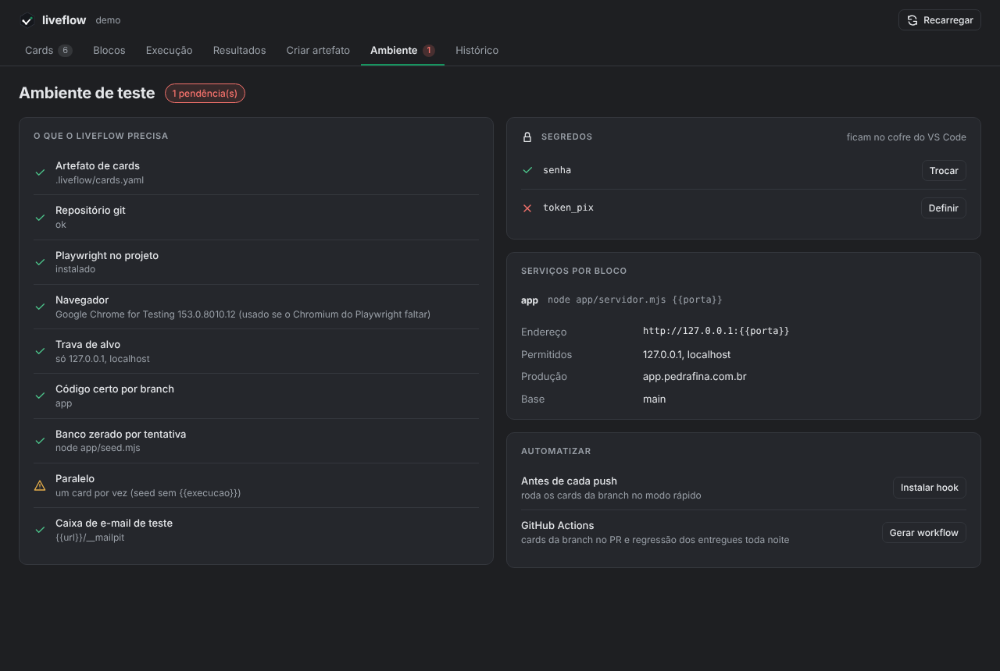
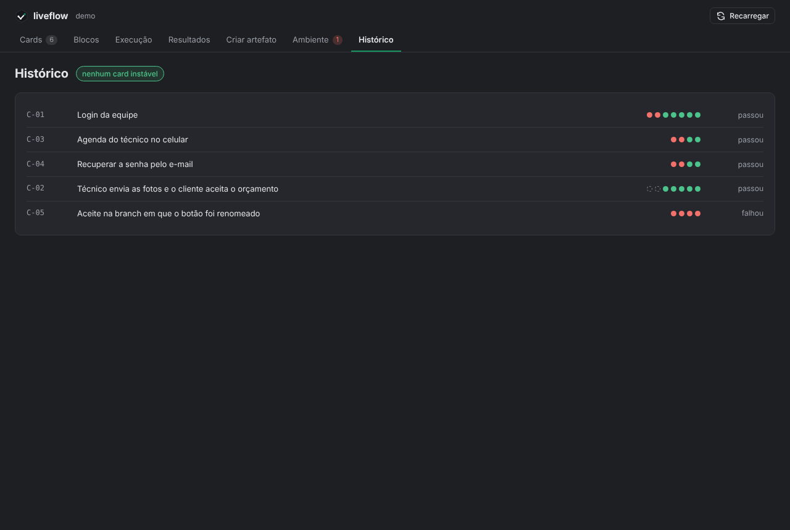

## Segredos

Ficam no **SecretStorage** do VS Code e só são passados ao processo do liveflow como variáveis de ambiente. Defina pela tela Ambiente ou pelo comando **liveflow: Definir segredo**.

## Tema claro

As telas usam as cores do tema do VS Code.

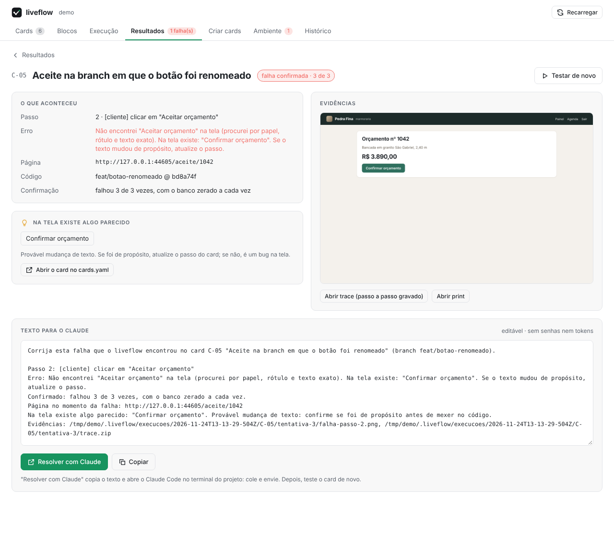
