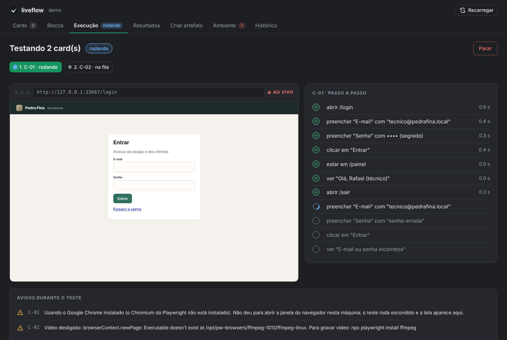
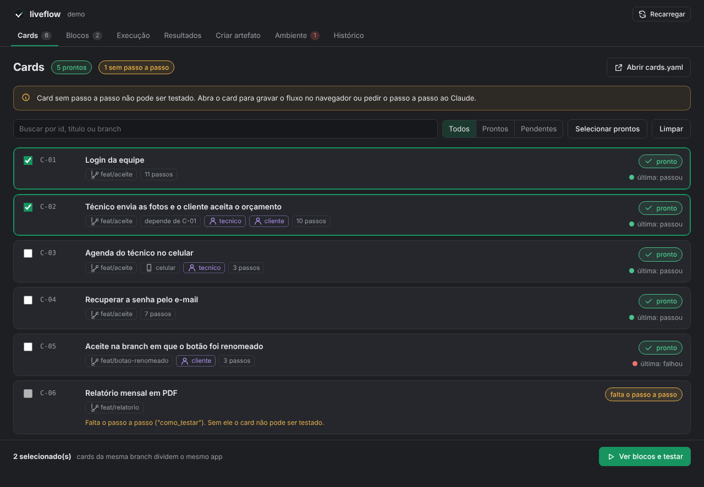
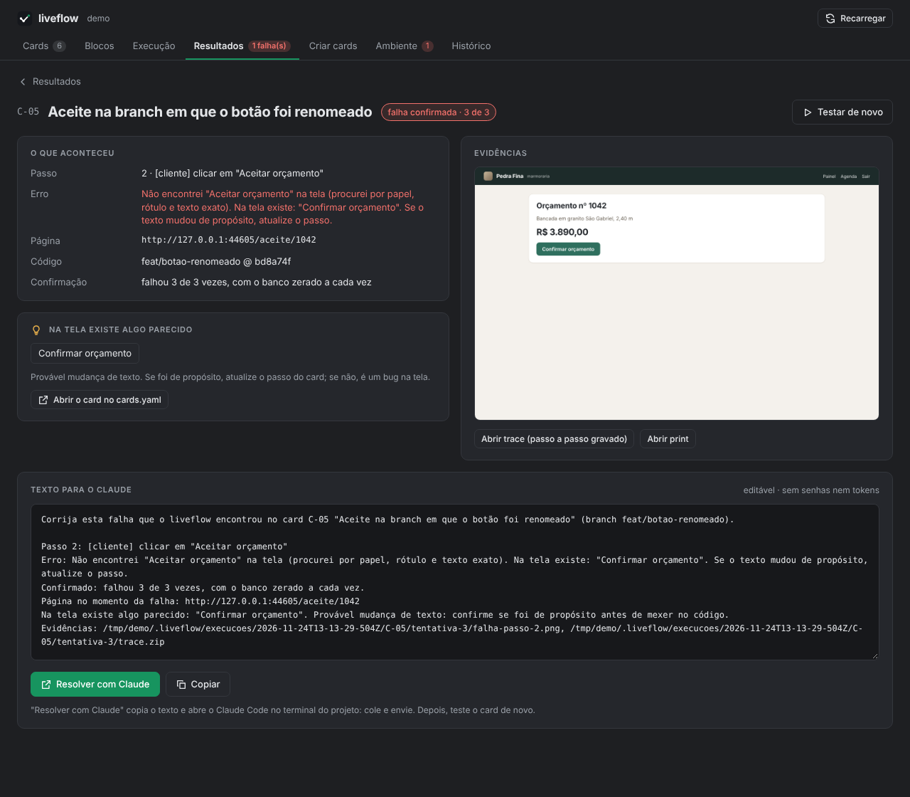
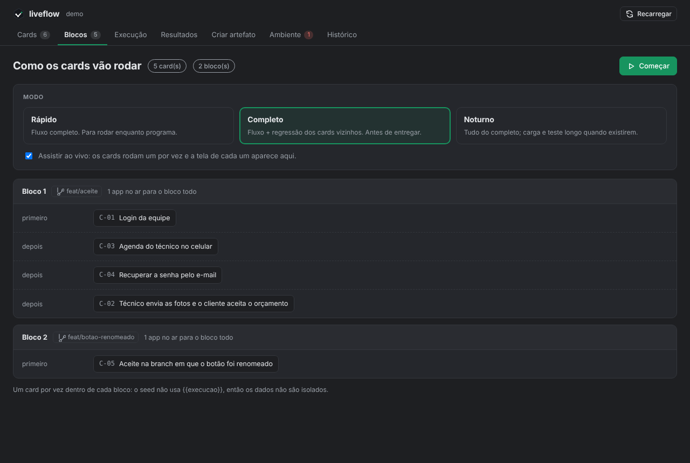

# liveflow

**Testa o fluxo de tela de cada card antes de entregar. A IA escreve; o liveflow executa.**

Cada card do `.liveflow/cards.yaml` tem os critérios de aceite e um passo a passo em linguagem simples (`abrir`, `clicar`, `preencher`, `ver_texto`…). O liveflow sobe o código da branch do card numa cópia isolada, zera o banco, executa os passos num navegador de verdade e só acusa falha quando ela se repete **3 de 3 vezes**.

## O que a extensão faz

- **Cards:** lista do `.liveflow/cards.yaml`, com o que falta em cada um. Card sem passo a passo não pode ser testado.
- **Card:** critérios com o passo que prova cada um, passo a passo, camadas de teste e histórico. Grave o fluxo no navegador ou peça o passo a passo ao Claude.
- **Blocos:** como os cards vão rodar (um app por branch, dependências, paralelo seguro) e o modo.
- **Execução ao vivo:** com um card, a tela do app aparece dentro do painel, passo a passo. Com vários, o progresso de cada um e a tentativa (1, 2 ou 3 de 3).
- **Problema:** falha confirmada, o que existe parecido na tela quando o texto mudou, print, trace e **Resolver com Claude**.
- **Criar cards** a partir das branches locais e remotas, **Ambiente** (segredos no cofre do VS Code, hook de pre-push, GitHub Actions) e **Histórico** com quarentena de testes instáveis.

## Requisitos

- **Node 22.18 ou mais novo** (configurável em `liveflow.node`).
- **Playwright** no projeto testado: `npm i -D playwright` e `npx playwright install chromium`. Sem o Chromium do Playwright, o liveflow usa o Google Chrome instalado.
- Um `.liveflow/cards.yaml` no projeto. Comece com o comando **liveflow: Criar artefato de cards** ou veja o [exemplo](https://github.com/joaocarpim/live-flow/tree/main/exemplo).

## Princípios

- A IA só escreve, nunca executa o teste.
- Só afirma o que foi verificado: sem garantia de qual código está no ar, o resultado é "não rodou".
- Repete antes de acusar; dois botões iguais = falha por ambiguidade, nunca um chute.
- Só testa endereços permitidos, nunca produção. Segredos ficam no cofre do VS Code.

## Mais

- [Documentação completa](https://github.com/joaocarpim/live-flow/tree/main/docs)
- [CLI, GitHub Action e plugin do Claude Code](https://github.com/joaocarpim/live-flow#readme)
- [Reportar um problema](https://github.com/joaocarpim/live-flow/issues)
